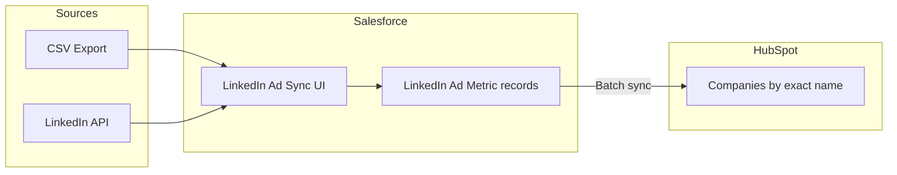
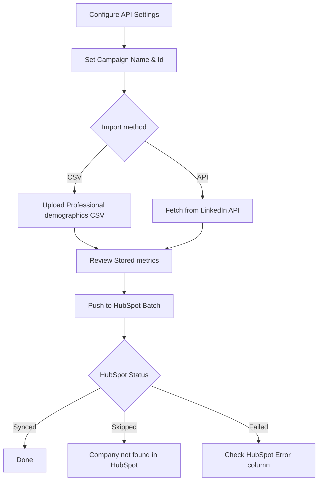
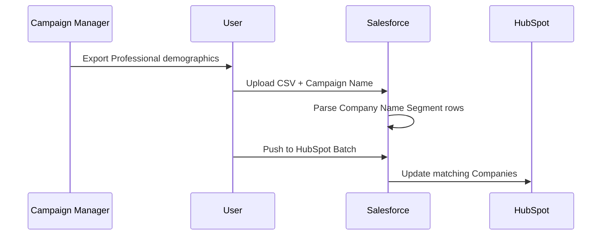
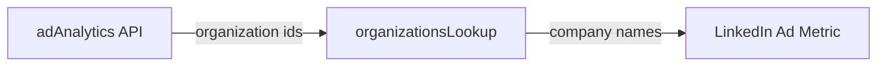
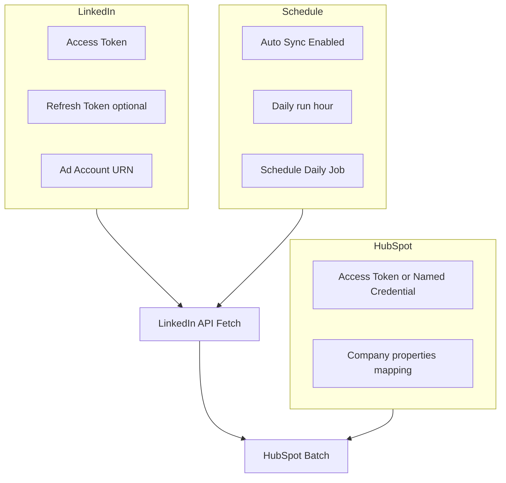

# LinkedIn Ad Metrics → HubSpot
## User Guide

**WhiteRock Tech · Salesforce LinkedIn Ad Sync**

---

## Overview

The **LinkedIn Ad Sync** component imports **Professional demographics** (Company Name Segment) from LinkedIn, stores metrics in Salesforce, and syncs them to **HubSpot Companies**.

**Key rules**

- Data is staged in Salesforce first, then pushed to HubSpot.
- HubSpot companies are matched by **exact company name** — no auto-create.
- Duplicate **Campaign + Company** pairs are **updated**, not duplicated.

---

## Where to open

In Salesforce, open the **LinkedIn Ad Sync** tab.

| Tab | Purpose |
|-----|---------|
| **Sync** | Campaign, dates, CSV/API import, metrics table, Push to HubSpot |
| **API Settings** | Tokens, auto-sync, daily schedule |

---

## End-to-end workflow

---

## Sync tab

### Campaign fields

| Field | Description |
|-------|-------------|
| **Campaign Name** | Name from Campaign Manager (required) |
| **LinkedIn Campaign Id** | Numeric campaign / ad set id |
| **Report Start** | Start date for API fetch |
| **Report End** | End date. **Empty = always today** |

**Finding the Campaign Id**

In Campaign Manager URL:

`.../accounts/506515554/campaigns?...&campaignIds=[704412604]`

| Value | Example | Use |
|-------|---------|-----|
| Ad Account | `506515554` | **LinkedIn Ad Account URN** in API Settings |
| Campaign / Ad set | `704412604` | **LinkedIn Campaign Id** on Sync tab |

Click **Save Sync Defaults** to persist campaign name, id, and dates. Empty Report End can be saved — fetch will always use **today**.

---

### Option A — CSV upload

1. Campaign Manager → **Export** → Report type: **Professional demographics**
2. Enter **Campaign Name** (and optional Campaign Id)
3. Choose CSV file
4. Rows appear in **Stored metrics** with `Source = CSV Upload`

---

### Option B — LinkedIn API fetch

1. Enter Campaign Name + Campaign Id
2. Set dates (or leave **Report End** empty = today)
3. Click **Fetch from LinkedIn API**

**Toast messages**

| Message | Meaning |
|---------|---------|
| `LinkedIn: N rows` | N company rows received |
| `Company names resolved: N/N` | Organization ids converted to names |
| `LinkedIn: 0 rows` | API returned empty — check id / date range |

Table shows `Source = LinkedIn API`.

---

### Push to HubSpot (Batch)

1. Confirm rows exist in **Stored metrics**
2. Click **Push to HubSpot (Batch)**
3. Wait for batch status

| HubSpot Status | Meaning |
|----------------|---------|
| **Pending** | Not synced yet |
| **Synced** | Metrics written to HubSpot Company |
| **Skipped** | No HubSpot Company with exact name |
| **Failed** | Error — see **HubSpot Error** |

---

## API Settings tab

### LinkedIn

1. **Access Token** (enable **Use LinkedIn Named Credential** for tokens longer than 255 chars)
2. Optional: **Refresh Token**, **Client Id**, **Client Secret**
3. **LinkedIn Ad Account URN** — e.g. `urn:li:sponsoredAccount:506515554`
4. **Save Settings** → **Test LinkedIn** → **Refresh LinkedIn Token** (if refresh configured)

### HubSpot

1. **HubSpot Access Token** (Private App) or Named Credential
2. Company properties must exist (impressions, clicks, conversions, campaign)
3. **Test HubSpot**
4. **HubSpot Batch Size** (e.g. 50)

### Daily auto-sync

1. Enable **Auto Sync Enabled**
2. Set **Auto Sync Lookback Days** and **Daily run hour** (0–23, org timezone)
3. Configure **Default Campaign Name / Id**
4. Click **Schedule Daily Job**

Daily job: fetch all active campaigns → run HubSpot batch.  
**Stop Daily Job** cancels schedule and disables auto-sync.

---

## Stored metrics table

| Column | Description |
|--------|-------------|
| Company | Company name |
| Impressions / Clicks / Conversions | Metrics |
| HubSpot Status / Error | Sync result |
| Source | `CSV Upload` or `LinkedIn API` |

---

## Quick start checklist

- [ ] API Settings: LinkedIn token + Ad Account URN + HubSpot token → Save → Test
- [ ] Sync: Campaign Name + Campaign Id → Save Sync Defaults
- [ ] Fetch from LinkedIn API or upload CSV
- [ ] Verify company **names** (not numeric ids)
- [ ] Push to HubSpot (Batch)
- [ ] Optional: Schedule Daily Job

---

## FAQ

**Fetch succeeded but table still shows old CSV?**  
Check toast row count. `0 rows` = empty API response for that period.

**Company column shows numeric ids?**  
Re-run Fetch after name lookup fix. Toast should show `Company names resolved: N/N`.

**HubSpot = Skipped?**  
Create or rename HubSpot Company to match Salesforce company name exactly.

**HubSpot = Failed (property doesn't exist)?**  
Create required company properties in HubSpot.

**Report End won't stay empty?**  
Clear field → **Save Sync Defaults**. Empty = today on every fetch.

**Which campaign id to use?**  
Use `campaignIds=[...]` from URL or ad set row — not Campaign Group id.

---

## Access requirements

- LinkedIn token with Advertising / Ad Analytics scopes
- HubSpot Private App with Companies read/write
- Salesforce access to LinkedIn Ad Sync tab and related objects

---

*Document generated for WhiteRock Tech LinkedIn Ad Sync integration.*
